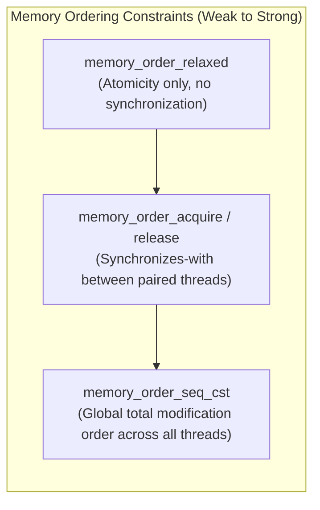

# C++20 Memory Model and Atomics Reference

The C++ memory model defines how threads interact through shared memory and establishes rules for compiler reordering, CPU cache synchronization, and hardware memory barriers.



## Memory Order Enumerations

| Memory Order | Operations | Hardware Cost | Semantic Guarantee |
| --- | --- | --- | --- |
| `memory_order_relaxed` | Load, Store, RMW | Zero fence cost on x86/ARM | Guarantees atomic read/write on the specific variable only. Permits arbitrary reordering of preceding and succeeding instructions. |
| `memory_order_consume` | Load | Deprecated in C++20 | Intended for data-dependent ordering. Standard compilers map this to `acquire`. |
| `memory_order_acquire` | Load, RMW | Zero cost on x86 (TSO); Load-Load/Load-Store barrier on ARM (`dmb.ishld`) | No memory reads or writes in the current thread can be reordered before this load. |
| `memory_order_release` | Store, RMW | Zero cost on x86 (TSO); Load-Store/Store-Store barrier on ARM (`dmb.ish`) | No memory reads or writes in the current thread can be reordered after this store. |
| `memory_order_acq_rel` | RMW | Combines acquire and release | Used on read-modify-write operations (e.g., `compare_exchange`, `fetch_add`). |
| `memory_order_seq_cst` | Load, Store, RMW | Full barrier (`mfence` / `lock` on x86, `dmb.ish` on ARM) | Enforces a single, globally consistent sequential order observed by all threads simultaneously. Default for `std::atomic`. |

---

## Synchronization Relationships

### 1. Sequenced-Before
Within a single thread, evaluation of expression $A$ is sequenced-before expression $B$ according to program order.

### 2. Synchronizes-With
An atomic store with `memory_order_release` in Thread 1 *synchronizes-with* an atomic load of that same variable with `memory_order_acquire` in Thread 2 when Thread 2 reads the value written by Thread 1.

### 3. Happens-Before
If $A$ is sequenced-before $B$, $A$ happens-before $B$. If $A$ synchronizes-with $B$, $A$ happens-before $B$. Memory writes that happen-before a read are visible to that read without race conditions.

---

## Production Implementation: Single-Producer Single-Consumer (SPSC) Ring Buffer

```cpp
#include <atomic>
#include <cstddef>
#include <optional>
#include <array>

template <typename T, size_t Capacity>
class SpscRingBuffer {
    static_assert((Capacity & (Capacity - 1)) == 0, "Capacity must be a power of two");

public:
    SpscRingBuffer() : head_(0), tail_(0) {}

    bool push(const T& item) {
        const size_t head = head_.load(std::memory_order_relaxed);
        const size_t tail = tail_.load(std::memory_order_acquire);

        if ((head - tail) >= Capacity) {
            return false; // Buffer full
        }

        buffer_[head & BufferMask] = item;
        head_.store(head + 1, std::memory_order_release);
        return true;
    }

    std::optional<T> pop() {
        const size_t tail = tail_.load(std::memory_order_relaxed);
        const size_t head = head_.load(std::memory_order_acquire);

        if (tail == head) {
            return std::nullopt; // Buffer empty
        }

        T item = buffer_[tail & BufferMask];
        tail_.store(tail + 1, std::memory_order_release);
        return item;
    }

private:
    static constexpr size_t BufferMask = Capacity - 1;
    alignas(64) std::array<T, Capacity> buffer_;

    // Separate head and tail onto distinct 64-byte cache lines to eliminate false sharing:
    alignas(64) std::atomic<size_t> head_;
    alignas(64) std::atomic<size_t> tail_;
};
```

### Explanation of Atomics in the SPSC Queue
1. In `push()`:
   - `head_` is loaded with `memory_order_relaxed` because only the single producer thread writes to `head_`.
   - `tail_` is loaded with `memory_order_acquire` to ensure reading items up to the consumer's published tail index does not reorder before checking availability.
   - Writing the payload into `buffer_` happens before publishing the new index.
   - `head_.store(..., memory_order_release)` synchronizes with the consumer's acquire load, ensuring the written slot contents are visible before the index advances.
2. In `pop()`:
   - Symmetrically, `tail_` advances using `memory_order_release` after the item is read, publishing slot release back to the producer.

---

## Hardware Architectures & Memory Ordering

- **x86-64 (Total Store Order / TSO):**
  - Hardware prevents Store-Load reordering on identical addresses, Load-Load, Store-Store, and Load-Store reordering.
  - Normal loads have acquire semantics at zero instruction overhead.
  - Normal stores have release semantics at zero instruction overhead.
  - `memory_order_seq_cst` requires an explicit hardware barrier (`lock cmpxchg` or `mfence`) to prevent Store-Load reordering across different memory locations.
- **ARM64 / Apple Silicon (Weakly Ordered):**
  - Hardware permits aggressive reordering of all loads and stores unless separated by explicit address dependency or barrier instructions (`dmb ishld`, `dmb ish`, `ldar`, `stlr`).
  - Acquire loads emit `ldar` (Load-Acquire Register).
  - Release stores emit `stlr` (Store-Release Register).
