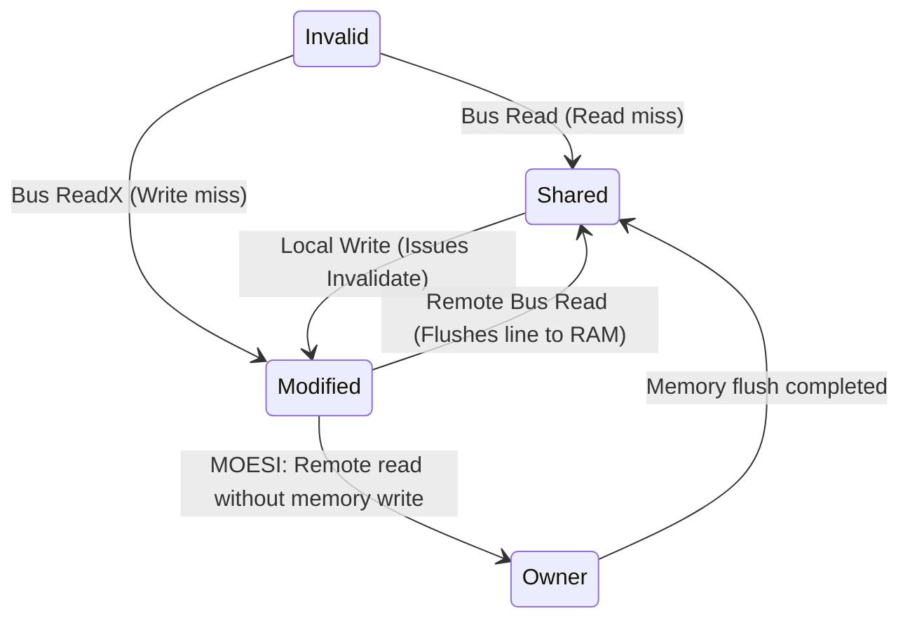

# CPU Cache Coherence: MESI & MOESI State Transitions

Hardware multi-core CPUs maintain memory consistency across private L1/L2 caches using snooping buses and finite state machine coherence protocols.

---

## 1. State Semantics (MOESI)

* **M (Modified):** Cache line is present only in current core; dirty (inconsistent with RAM).
* **O (Owner):** Cache line is shared among multiple cores, but current core owns the writeback responsibility.
* **E (Exclusive):** Cache line is present only in current core; clean (matches RAM).
* **S (Shared):** Cache line may be present in other cores; read-only.
* **I (Invalid):** Cache line contains no valid data.
