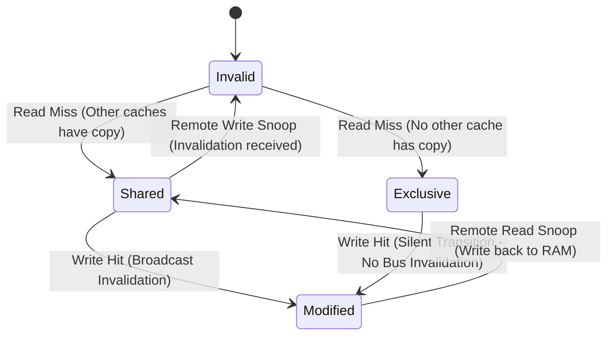

# CPU Cache Coherence: MESI & MOESI Protocols

Hardware cache coherence guarantees that writes to memory locations by one core become visible to all other cores through state machine transitions over the CPU interconnect.

---

## 1. Cache Line States

| State | Description | Dirty (Memory out of sync)? | Can Read? | Can Write? |
|---|---|---|---|---|
| **M (Modified)** | Line present only in this core; value is updated | Yes | Yes | Yes (local) |
| **O (Owned - MOESI)**| Line present in multiple cores; this core is owner responsible for write-back | Yes | Yes | No (must invalidate others) |
| **E (Exclusive)** | Line present only in this core; matches RAM | No | Yes | Yes (transitions to M silently) |
| **S (Shared)** | Line present in this and other cores; matches RAM | No | Yes | No (requires RFO broadcast) |
| **I (Invalid)** | Line contains stale data; must fetch from L3/DRAM | N/A | No | No |

---

## 2. Request For Ownership (RFO) Latency Penalty

When a core writes to a shared cache line, it broadcasts a Request For Ownership (RFO) across the UPI/Infinity Fabric interconnect, invalidating the line in all other core caches. This incurs an interconnect round-trip penalty of 40–120 nanoseconds.
