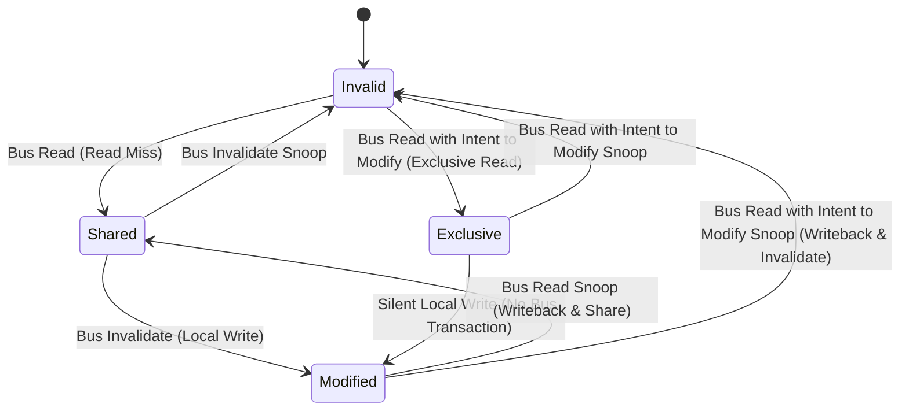

# MESI CPU Cache Coherence Protocol

The MESI protocol (also known as the Illinois protocol) maintains consistency across L1/L2/L3 data caches in symmetric multiprocessing (SMP) systems via write-invalidate bus snooping.



---

## 1. Protocol States

| State | Definition | Cache Line Status | Main Memory Status | Bus Action on Write |
|---|---|---|---|---|
| **M (Modified)** | Line exists only in current cache; value is dirty. | Valid, exclusive, dirty | Stale | None (silent local write) |
| **E (Exclusive)** | Line exists only in current cache; value matches memory. | Valid, exclusive, clean | Up-to-date | Transition to **M** (no bus traffic) |
| **S (Shared)** | Line may exist in multiple caches; value is clean. | Valid, shared, clean | Up-to-date | Broadcast **BusUpgr** (invalidation) |
| **I (Invalid)** | Line contains no valid data. | Invalid | Irrelevant | Issue **BusRdX** (Read Invalidate) |

---

## 2. Bus Snooping Transactions

1. **BusRd (Bus Read)**:
   - Issued on read miss.
   - Other caches monitor the bus. If another cache holds the line in **M**, it flushes the dirty data to the bus/memory and transitions to **S**.
   - If line is clean in other caches, it transitions to **S**. If no other cache holds it, requester transitions to **E**.

2. **BusRdX (Bus Read with Intent to Modify)**:
   - Issued on write miss to an invalid or missing line.
   - Requests data while broadcasting an invalidation signal. All peer caches invalidate their copies (**I**). Requester transitions to **M**.

3. **BusUpgr (Bus Upgrade)**:
   - Issued on write hit to a **Shared (S)** line.
   - Does not request data from memory; only broadcasts an invalidation signal to force peer caches into **I**. Requester transitions to **M**.

4. **BusFlush (Writeback)**:
   - Line is evicted or snooped in **M** state. Dirty contents write back to L3 or main memory.

---

## 3. Store Buffers and Invalid Queues

Hardware implementations decouple CPU execution pipelines from bus serialization latency using asynchronous FIFO queues:

```
[ CPU Core ] <---> [ Store Buffer ] <---> [ L1 Data Cache ]
                                                  ^
                                                  | (Bus Invalidate)
                                                  v
                                          [ Invalidate Queue ]
```

### Store Buffer Optimization
- A CPU core executing a store instruction writes immediately to its private **Store Buffer** rather than waiting for bus invalidation acknowledgments.
- Core resumes execution speculatively.
- When all invalidation ACKs return over the interconnect, buffered writes drain into the L1 cache.

### Invalidate Queue Optimization
- To avoid stalling peer cores during heavy write invalidations, incoming invalidation requests land in an **Invalidate Queue**.
- The core immediately sends an ACK, but delays the actual cache line eviction until the queue drains.

---

## 4. Hardware Memory Barriers

Because Store Buffers and Invalidate Queues reorder visibility across cores, explicit memory barrier instructions enforce sequential consistency:

### Store Barrier (`smp_wmb()` / `sfence`)
- Flushes the local Store Buffer before any subsequent writes become visible.
- Guarantees that preceding stores reach cache and bus before following stores.

### Load Barrier (`smp_rmb()` / `lfence`)
- Flushes the local Invalidate Queue before any subsequent loads execute.
- Guarantees that preceding invalidations complete, preventing stale reads from L1.

### Full Barrier (`smp_mb()` / `mfence`)
- Serializes both Store Buffers and Invalidate Queues, enforcing total store order across memory reads and writes.

---

## 5. False Sharing Mitigation

When two independent variables share the same 64-byte cache line and are modified concurrently by different cores, the cache line bounces perpetually between cores in state **M** and **I**:

```cpp
// Cache-line bouncing penalty
struct FalseSharing {
    alignas(64) uint64_t core0_counter; // Offset 0..7  (isolated 64-byte line)
    alignas(64) uint64_t core1_counter; // Offset 64..71 (isolated 64-byte line)
};
```

Padding data structures to `hardware_destructive_interference_size` (64 bytes on x86-64 and ARM64) eliminates cross-core ping-pong traffic.
