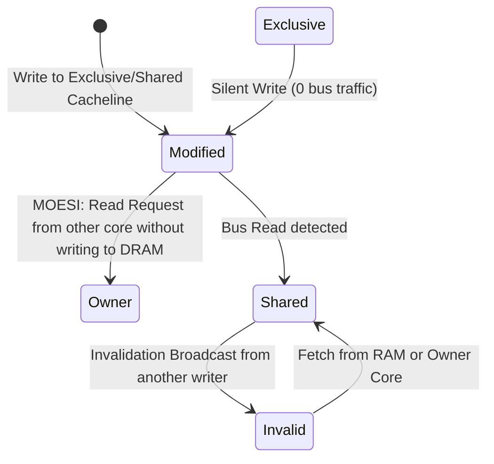

# Computer Architecture: MESI and MOESI Cache Coherence Protocols

Multi-core processors maintain consistent memory views across private L1/L2 caches using bus snooping coherence protocols.

---

## 1. MOESI Owner State
The **Owner (O)** state in AMD and ARM processors allows a core to share dirty modified data directly with other cores without writing it back to slow DDR memory.
