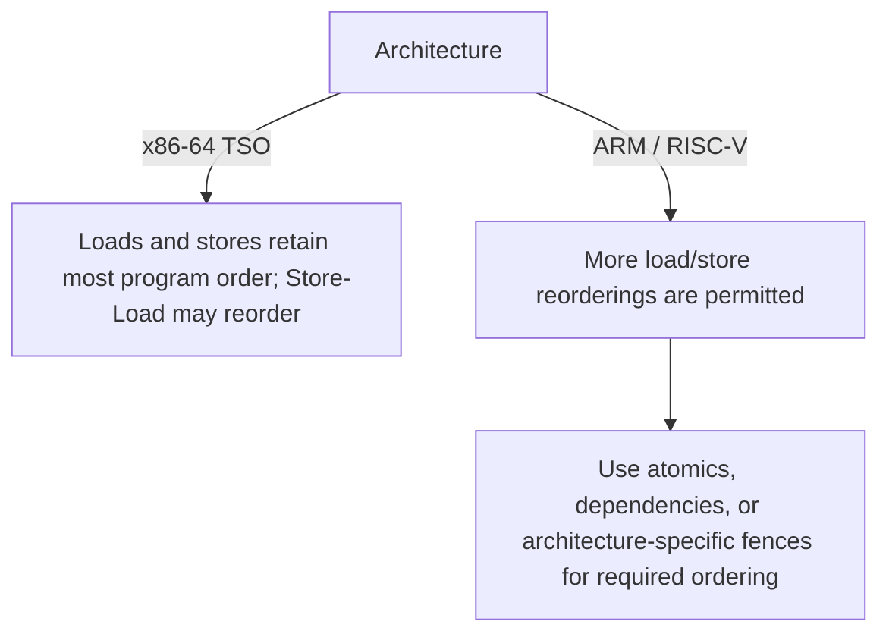

# Hardware Concurrency: x86-64 TSO vs ARM/RISC-V Weak Memory Models

CPU memory models define which orderings of memory operations other cores may observe. x86-64 TSO preserves load-load, load-store, and store-store order for ordinary memory, while a store followed by a load to a different location may be observed out of order. ARM and RISC-V allow additional reorderings unless dependencies, acquire/release operations, or fences establish the required ordering. The exact guarantees depend on the architecture and instruction used; “weak” does not mean operations can be reordered arbitrarily.

## 1. Cross-platform pitfall

A concurrency bug may stay hidden on x86-64 because its hardware ordering is stronger than the program requires. It can become visible on ARM64 or RISC-V. In C and C++, however, a data race is undefined behavior regardless of the processor: use language-level atomics or locks to establish synchronization. Do not try to repair a C++ data race by inserting an architecture-specific hardware fence around ordinary non-atomic variables.

Hardware memory models and language memory models are separate layers. A compiler may reorder operations when the language rules permit it, even if the CPU would preserve their emitted instruction order.

## References

- Arm, [Armv8-A memory model guide](https://developer.arm.com/-/media/Arm%20Developer%20Community/PDF/Learn%20the%20Architecture/Armv8-A%20memory%20model%20guide.pdf).
- C++ draft, [Data races](https://eel.is/c++draft/intro.races).
- RISC-V International, [Unprivileged ISA, RVWMO memory consistency model](https://docs.riscv.org/reference/isa/unpriv/rvwmo.html).
