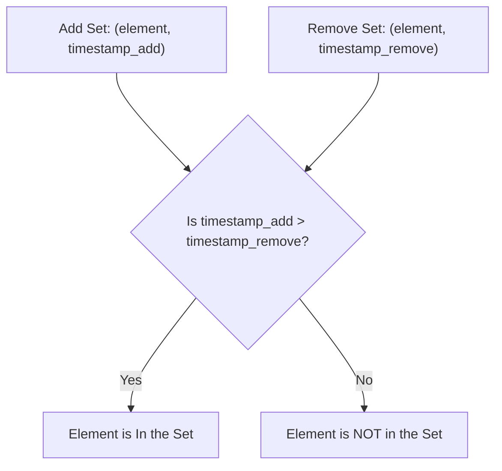

# CRDTs: Last-Write-Wins Element Set (LWW-Element-Set)

The LWW-Element-Set manages additions and removals of elements using timestamps, resolving race conditions between add and remove operations deterministically.

---

## 1. Bias Configuration
When timestamps are identical ($t_{add} = t_{remove}$), tie-breaking rules determine behavior:
- **Add-bias:** Element is considered present.
- **Remove-bias:** Element is considered removed.
