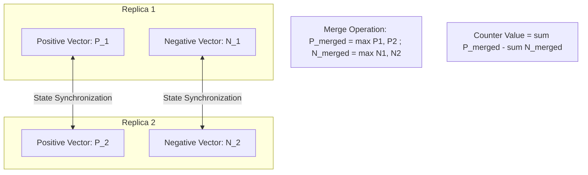

# CRDT Architecture: PN-Counters & LWW-Element-Set

Conflict-Free Replicated Data Types guarantee eventual consistency across network partitions without distributed lock coordination by utilizing join-semilattice algebraic properties.

---

## 1. Join-Semilattice Properties

Any state-based (CvRDT) merge operator $\sqcup$ must satisfy:
1. **Commutativity:** $x \sqcup y = y \sqcup x$
2. **Associativity:** $(x \sqcup y) \sqcup z = x \sqcup (y \sqcup z)$
3. **Idempotence:** $x \sqcup x = x$
