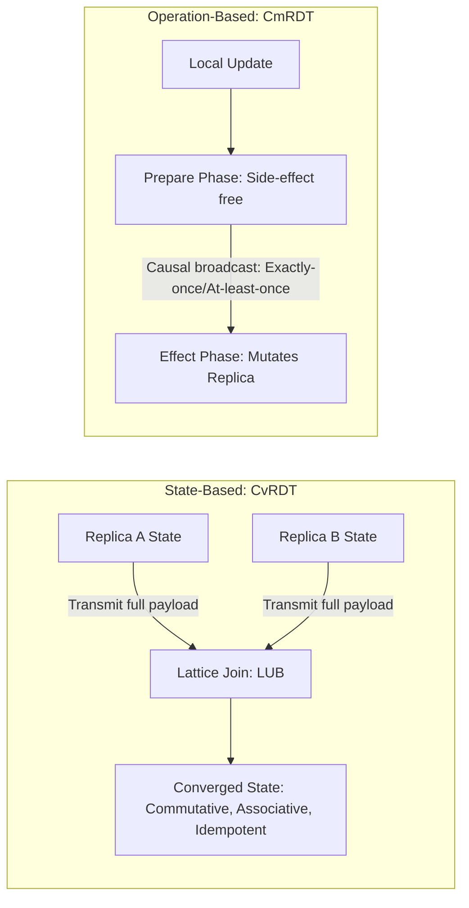

# CRDTs: State-Based (CvRDT) vs Operation-Based (CmRDT)

Conflict-Free Replicated Data Types resolve concurrent updates across peer-to-peer networks without distributed locks, converging deterministically through algebraic properties.

---

## 1. Mathematical Requirements

* **CvRDT Join-Semilattice:** States form a partial order with a Least Upper Bound (LUB) join operator ($\sqcup$) satisfying:
  * **Associativity:** $(a \sqcup b) \sqcup c = a \sqcup (b \sqcup c)$
  * **Commutativity:** $a \sqcup b = b \sqcup a$
  * **Idempotence:** $a \sqcup a = a$
* **CmRDT Invariants:** Operations must commute with all concurrent operations. Messaging layers must enforce causal ordering.
