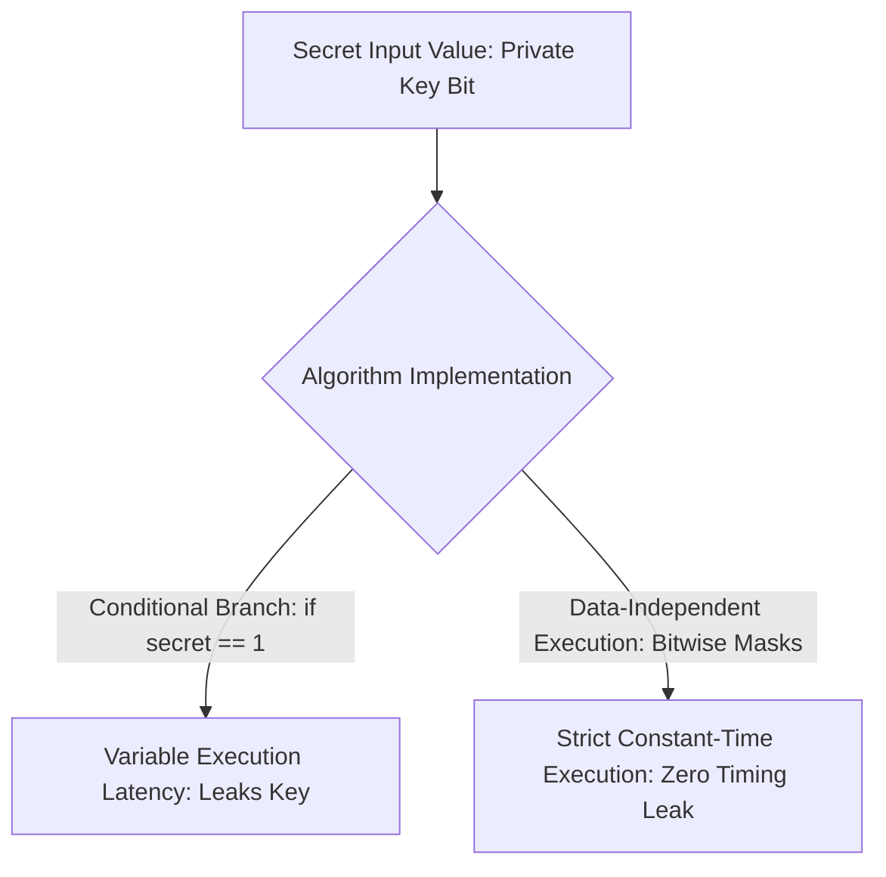

# Cryptography: Constant-Time Implementation & Timing Defenses

Cryptographic algorithms must execute in constant time relative to secret inputs to eliminate timing side-channel vulnerabilities that expose private keys to unprivileged observers.



---

## 1. Core Constant-Time Rules

1. **No Secret Branching:** Secret values must never determine control flow paths (`if`, `switch`, loops bounded by secret values).
2. **No Secret Memory Indexing:** Secret values must never index lookup tables or memory addresses, as cache hit/miss latencies leak offset locations.
3. **No Variable-Latency Instructions:** Avoid instructions whose clock-cycle latency depends on operand values on target hardware (e.g., integer division `div`, multi-bit shifts on older cores).

### Idiomatic Constant-Time Selection

```c
/* Returns (a) when condition == 0xFFFFFFFF, or (b) when condition == 0x00000000 */
uint32_t ct_select_u32(uint32_t condition_mask, uint32_t a, uint32_t b) {
    return (condition_mask & a) | (~condition_mask & b);
}

/* Returns 0 if buffers match, non-zero otherwise, in constant time */
int ct_memcmp(const uint8_t *a, const uint8_t *b, size_t len) {
    uint8_t diff = 0;
    for (size_t i = 0; i < len; ++i) {
        diff |= a[i] ^ b[i];
    }
    return (int)diff;
}
```
