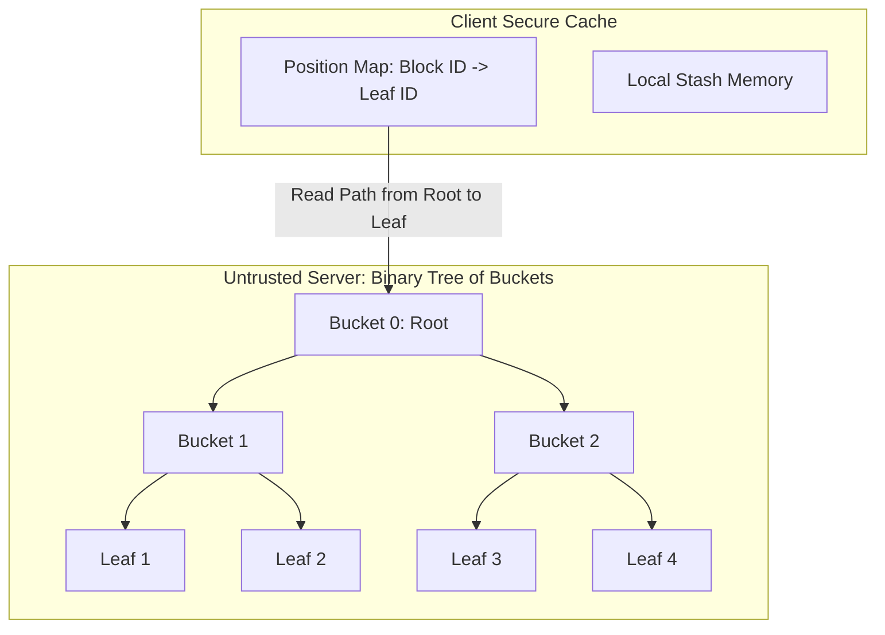

# Confidential Computing: Path ORAM (Oblivious RAM)

Oblivious RAM (ORAM) eliminates access pattern leakage on untrusted storage providers by randomizing memory locations and re-encrypting blocks on every read and write operation.

---

## 1. Path ORAM Operation Cycle

1. **Lookup:** Client consults local Position Map to determine leaf node $L$ assigned to target block $a$.
2. **Read Path:** Client reads and decrypts all buckets along the path from Root to Leaf $L$ into its local Stash.
3. **Remap:** Client assigns block $a$ a uniformly random new leaf $L' \leftarrow 	ext{Random}()$ in the Position Map.
4. **Write Path:** Client writes blocks from Stash back to the path toward $L$ as far down the tree as possible, padding remaining bucket slots with encrypted dummy blocks.
