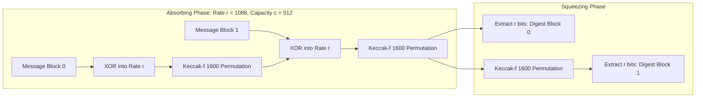

# Cryptography: Keccak Sponge Construction & SHA-3 Internals

The Keccak sponge construction operates on a 1600-bit state array divided into bitrate $r$ and capacity $c$, alternating between absorbing input messages and squeezing output digests.

---

## 1. State Matrix & Round Functions

* **3D State Array:** $5 	imes 5$ lanes of 64-bit words ($5 	imes 5 	imes 64 = 1600	ext{ bits}$).
* **Five Permutation Steps:** Each of the 24 rounds executes:
  - $	heta$ (Theta): Parity diffusion across columns.
  - $
ho$ (Rho): Bitwise rotation within individual lanes.
  - $\pi$ (Pi): Permutation and transposition of lane coordinates.
  - $\chi$ (Chi): Non-linear algebraic layer (providing cryptographic confusion).
  - $\iota$ (Iota): XORing round constants into lane $[0, 0]$ to break symmetry.
