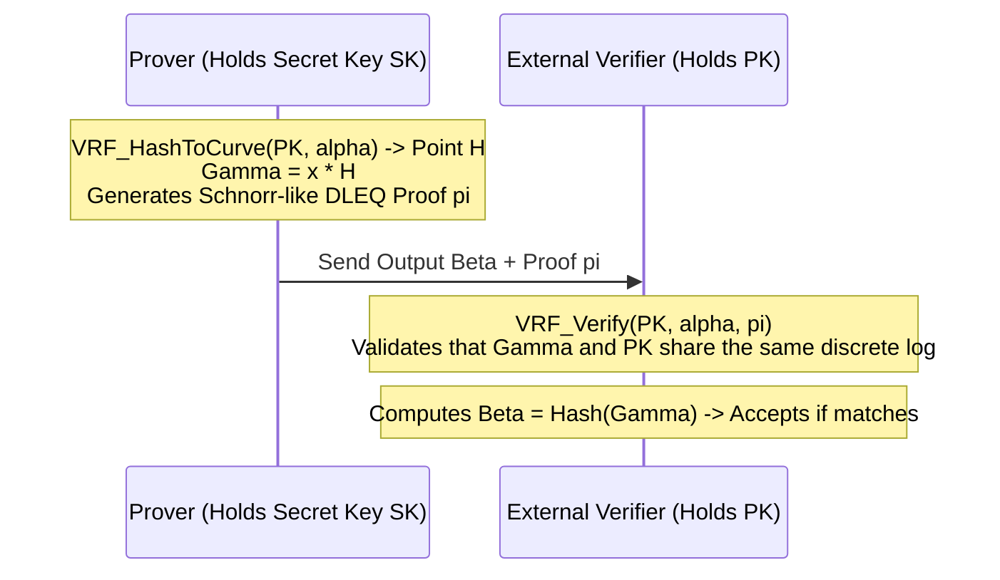

# Cryptography: Verifiable Random Functions (ECVRF RFC 9381)

A Verifiable Random Function (VRF) operates as a cryptographic public-key version of a keyed hash: given an input $x$ and private key $SK$, it generates a pseudorandom output $Y$ along with an unforgeable proof $\pi$ that any observer can verify against $PK$.

---

## 1. Core Cryptographic Invariants

* **Uniqueness:** For any fixed public key $PK$ and input $lpha$, there exists strictly one valid pseudorandom output value $eta$.
* **Pseudorandomness:** Without knowledge of secret key $SK$, output $eta$ is computationally indistinguishable from uniform random noise to any observer.
* **Consensus Applications:** Used in proof-of-stake distributed leader elections (e.g., Algorand, Cardano) to privately evaluate leadership lotteries without exposing identity before block proposal.
