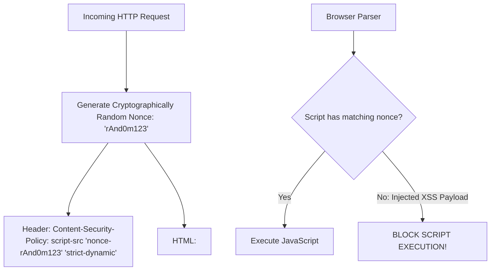

# Web Security: Content Security Policy Level 3 Strict Nonce Architecture

Legacy domain allowlists in CSP are easily bypassed via JSONP endpoints and open redirects. Strict Nonce CSP defeats Cross-Site Scripting (XSS) by verifying dynamic cryptographic nonces.

---

## 1. `'strict-dynamic'` Directive
Enables scripts that carry a valid nonce to dynamically load downstream dependencies without explicitly declaring every vendor URL in the policy header.
