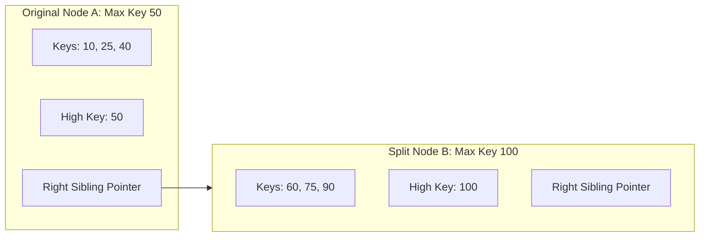

# Database Engines: Lehman-Yao B-link Tree Concurrency

The B-link tree eliminates read locks and avoids top-down tree locking during node splits by adding high keys and right-sibling pointers to every node.

---

## 1. Concurrency Invariants

1. **Latch-Free Reader Traversal:** Readers search nodes without acquiring latches. If a target key exceeds the node's `High Key`, the reader follows the right-sibling pointer across the same level.
2. **Bottom-Up Splits:** Writers latch only the node undergoing modification. When splitting, the writer creates the right sibling, updates pointers, and propagates parent references upwards asynchronously.
3. **Deadlock Elimination:** Nodes are traversed strictly left-to-right and bottom-to-top, eliminating cyclic lock dependencies across concurrent transactions.
