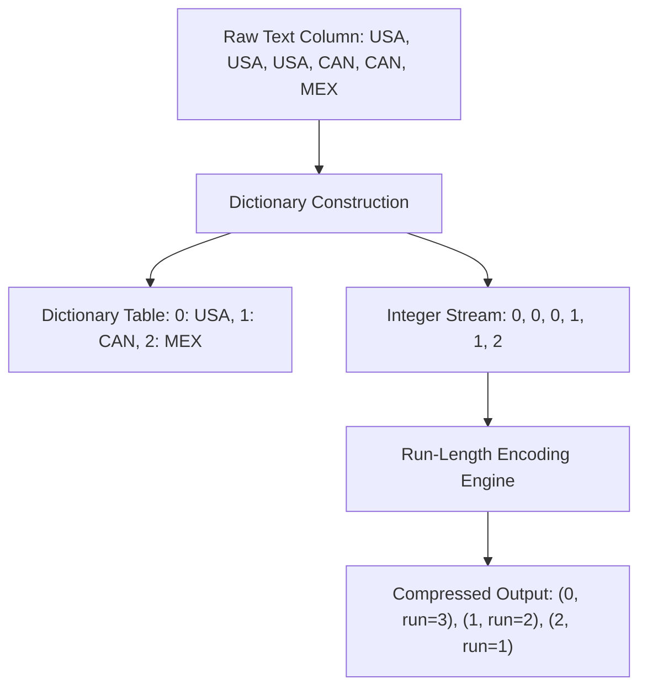

# Columnar Storage: Dictionary & Run-Length Encoding (RLE)

Columnar execution engines (Apache Parquet, ClickHouse, DuckDB) compress sorted data columns by combining fixed-length Dictionary Encoding with Run-Length Encoding.

---

## 1. Operating Metrics & SIMD Acceleration

* **Bit-Packing:** Dictionary indices are bit-packed to the minimum bitwidth required ($\lceil \log_2 N 
ceil$ bits, e.g., 2 bits for 4 distinct values).
* **Predicate Pushdown:** Filter queries (`WHERE country = 'USA'`) compare against the dictionary entry once (`id == 0`), evaluating remaining blocks with SIMD vector equality comparisons directly on packed indices without string decoding.
