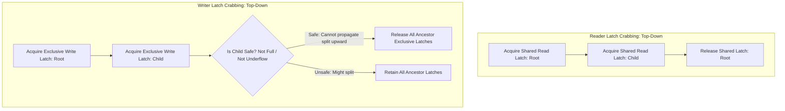

# Database Engines: B-Tree Latch Crabbing & Optimistic Coupling

Latch Crabbing (Lock Coupling) governs concurrent access to B-trees by acquiring child latches before releasing parent latches, ensuring safe tree modifications without global synchronization.

---

## 1. Latch Invariants

* **Safe Nodes:** A node is "safe" for an insertion if `keys.length < MAX_KEYS` (cannot trigger a split); safe for a deletion if `keys.length > MIN_KEYS`.
* **Optimistic Coupling:** Modern engines read nodes using version numbers without latches. If a version mismatch is detected after payload reading, the thread retries with explicit shared latches.
