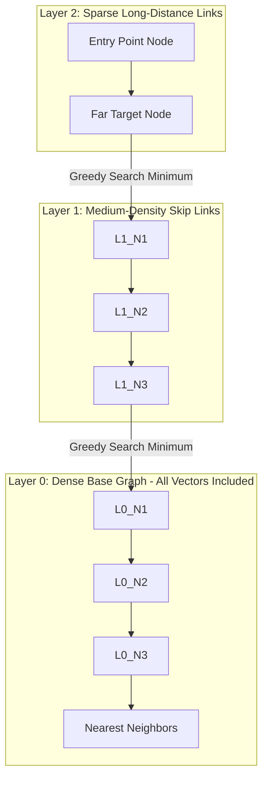

# Vector Databases: Hierarchical Navigable Small World (HNSW) Indexing

HNSW accelerates Approximate Nearest Neighbor (ANN) vector search by constructing a multi-layer geometric graph where upper layers provide long-range skips and bottom layers perform dense local refinement.

---

## 1. Algorithmic Parameters

* **`M`:** Maximum number of bidirectional connection edges per node in the graph.
* **`efConstruction`:** Size of the dynamic candidate list evaluated during index construction; trades build time for graph connectivity.
* **`efSearch`:** Size of the priority queue evaluated during query execution; balances recall accuracy against query latency.
* **Heuristic Pruning:** Replaces simple distance sorting with geometric diversity pruning to avoid clustering redundant edges in identical angular directions.
