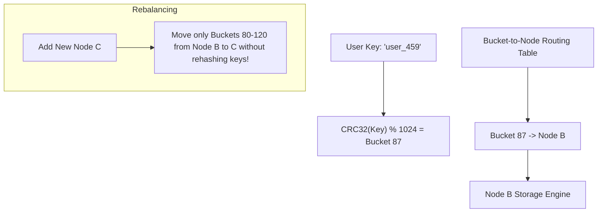

# Distributed Data: Virtual Buckets Sharding Architecture

Direct physical sharding makes rebalancing painful. Virtual bucketing (used in Couchbase and DynamoDB) decouples logical keyspaces from physical nodes.

---

## 1. Constant Shard Count
The total number of virtual buckets (e.g. 1,024) remains static for the lifetime of the cluster, eliminating table-wide data rewrites when physical servers scale.
