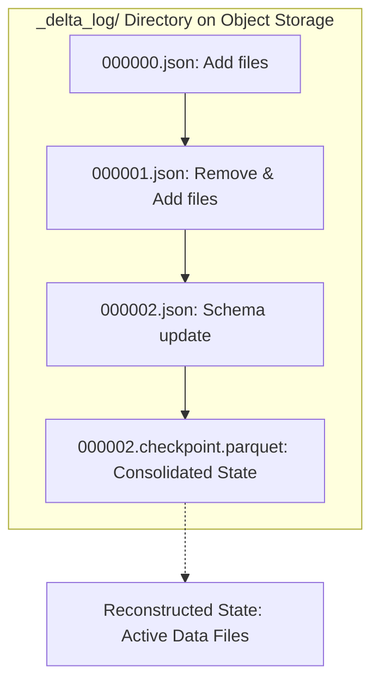

# Delta Lake: ACID Transaction Log & Checkpoint Protocol

Delta Lake provides ACID guarantees over cloud object storage (S3/GCS/Azure) via a serialized commit log (`_delta_log/`) and periodic Parquet checkpoints.

---

## 1. Concurrency Protocol

1. **Optimistic Concurrency Control (OCC):** Writers read current table state, attempt speculative writes, and commit by creating the next sequential JSON file.
2. **Atomic Put-If-Absent:** Commits rely on object storage atomic put primitives to resolve write races, aborting conflicting transactions.
3. **Checkpoint Pruning:** Every 10 commits, Delta Lake consolidates JSON log files into a single Parquet checkpoint file to speed up metadata parsing.
