# Application Security: Untrusted Deserialization & JNDI Injection (Apache Roller CVE-2026-129448, SAP NetWeaver CVE-2025-42884)

Two vulnerabilities added to the CISA Known Exploited Vulnerabilities (KEV) catalog on 2026-11-20 show the same root cause in two different shapes: **attacker-controlled data reaches a Java object-instantiation or name-lookup primitive before it is validated**.

---

## 1. Attack Path Overview

```mermaid
flowchart TD
    subgraph Roller["Apache Roller - CVE-2026-129448 (CVSS 9.8)"]
        R1["Unauthenticated XML-RPC request"] --> R2["Parser accepts vendor extension types"]
        R2 --> R3["Deserialization happens BEFORE authentication"]
        R3 --> R4["Arbitrary code execution"]
    end

    subgraph SAP["SAP NetWeaver Enterprise Portal - CVE-2025-42884 (CVSS 6.5)"]
        S1["SOAP call to DefaultService_PcmSi (list operation)"] --> S2["env parameter carries EnvironmentElement entries"]
        S2 --> S3["java.naming.factory.initial / java.naming.provider.url overridden"]
        S3 --> S4["JNDI lookup against attacker-chosen provider"]
        S4 --> S5["Remote class/object loading -> potential RCE"]
    end
```

---

## 2. Comparison

| Dimension | Apache Roller (CVE-2026-129448) | SAP NetWeaver EP (CVE-2025-42884) |
| :--- | :--- | :--- |
| **Weakness class** | Deserialization of untrusted data | Improper neutralization in data query logic (JNDI environment injection) |
| **Entry point** | XML-RPC endpoint | SOAP service `DefaultService_PcmSi`, operation `list` |
| **Auth required** | None (parsing precedes auth) | None |
| **Attacker-controlled input** | Vendor extension types in XML-RPC payload | `env` parameter, JNDI properties `java.naming.factory.initial`, `java.naming.provider.url` |
| **Impact** | Remote code execution | Information disclosure/modification, escalating to RCE via deserialization |
| **CVSS** | 9.8 | 6.5 (criticality understated by score) |
| **Fix** | Roller November 2026 release | SAP Security Note 3660969 |
| **Exploitation notes** | Maintainers confirmed active exploitation | Targeted, no public exploit (per Onapsis) |

The SAP case is the standard lesson that **CVSS alone under-ranks bugs that chain into RCE**.

---

## 3. Why These Primitives Are Dangerous

| Primitive | What the runtime does | Why attacker input is unsafe |
| :--- | :--- | :--- |
| `ObjectInputStream.readObject()` / XML-RPC extension types | Rebuilds an object graph and invokes `readObject`/`readResolve` hooks | Existing classes on the classpath can be chained ("gadgets") so that deserialization alone triggers dangerous behaviour |
| `InitialContext.lookup()` with caller-supplied environment | Resolves a name through the configured provider | If the provider URL is attacker-chosen, the application contacts an attacker host and may deserialize or load what it returns |

Key point: neither requires a memory-corruption bug. They abuse **intended features** reached with unintended input.

---

## 4. Defensive Checklist

* **Patch first.** Apply the Apache Roller November 2026 fix and SAP Security Note 3660969.
* **Never deserialize before authenticating.** Authentication and authorization checks must run before any body parsing that can instantiate types.
* **Allow-list types.** Use a deserialization filter (JEP 290 / `ObjectInputFilter`) with an explicit allow-list, not a deny-list of known gadgets.
* **Do not let callers set JNDI environment keys.** Fix `java.naming.factory.initial` and `java.naming.provider.url` server-side; reject request-supplied values.
* **Prefer data-only formats.** JSON or Protobuf into fixed DTOs avoids polymorphic type instantiation.
* **Restrict egress.** Application servers should not initiate outbound connections to arbitrary hosts (blocks remote JNDI provider callbacks).
* **Reduce exposure.** Do not expose XML-RPC, SOAP admin services or Enterprise Portal endpoints to the internet unless required.

---

## 5. Detection Hints

* Outbound connections from the app server to unexpected hosts shortly after SOAP/XML-RPC requests.
* Requests to `DefaultService_PcmSi` whose `env` entries contain `java.naming.*` keys.
* A burst of malformed SOAP calls rejected by schema validation followed by one well-formed request (Onapsis observed this pattern: most requests failed, one reached the vulnerable code path).
* Unauthenticated POSTs to the Roller XML-RPC endpoint from external addresses.

---

## References

* CISA KEV alert, 2026-11-20
* The Hacker News, "Hackers Exploit Critical VMware, Cisco, and Apache Flaws as Espionage Attacks Emerge", 2026-11-21
* Onapsis analysis of CVE-2025-42884
