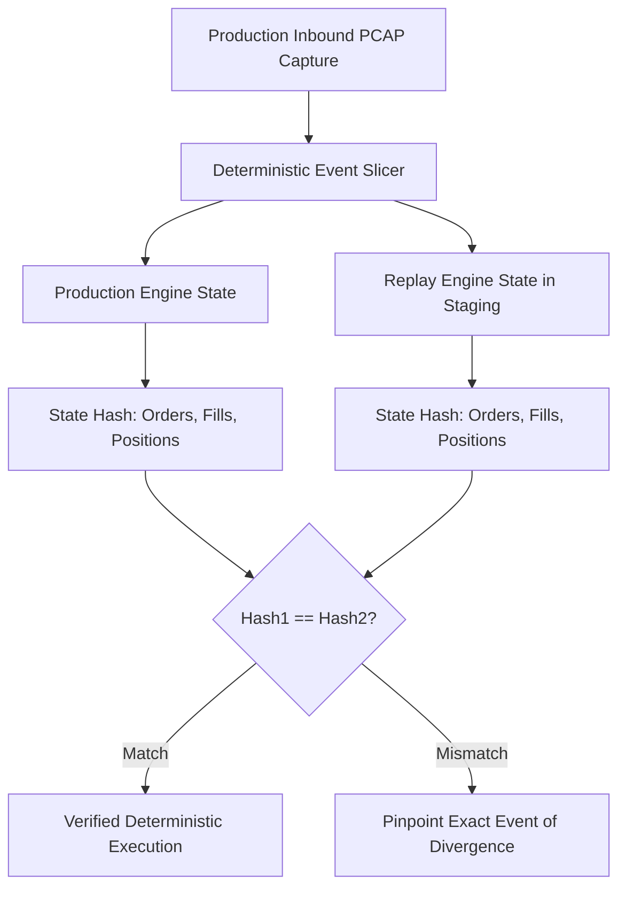

# Deterministic Replay Architecture for Trading Engines

Deterministic execution engines guarantee identical state transitions and outputs when fed the same sequence of inbound market events.

---

## 1. Eliminating Non-Deterministic Sources

To guarantee exact replay:
- **No System Clocks**: Inbound events carry external hardware sequence numbers and timestamps. The engine's internal clock advances strictly via event timestamps.
- **No Dynamic Pointers in Logic**: Hash maps and ordering logic must not iterate over raw pointer addresses. Use deterministic sequence IDs.
- **Single-Threaded Execution Core**: Pinned event loop avoids thread interleaving races.
