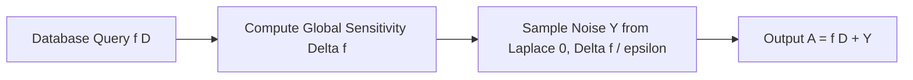

# Differential Privacy & Laplace Noise Calibration

Differential privacy provides mathematical bounds ensuring an adversary cannot determine whether any single individual's record was included in a statistical dataset query.

---

## 1. Mathematical Definition ($(\epsilon, \delta)$-DP)

A randomized algorithm $\mathcal{M}$ satisfies $(\epsilon, \delta)$-differential privacy if for all neighboring datasets $D_1, D_2$ differing on a single row, and all query outcomes $S \subseteq 	ext{Range}(\mathcal{M})$:

$$\mathbb{P}[\mathcal{M}(D_1) \in S] \le e^\epsilon \cdot \mathbb{P}[\mathcal{M}(D_2) \in S] + \delta$$

* $\epsilon$ (Privacy Loss Budget): Smaller $\epsilon$ yields stronger privacy and higher injected noise.
* $\delta$ (Failure Probability): Probability that strict $\epsilon$-bound is violated (typically $\delta \ll 1/|D|$).
