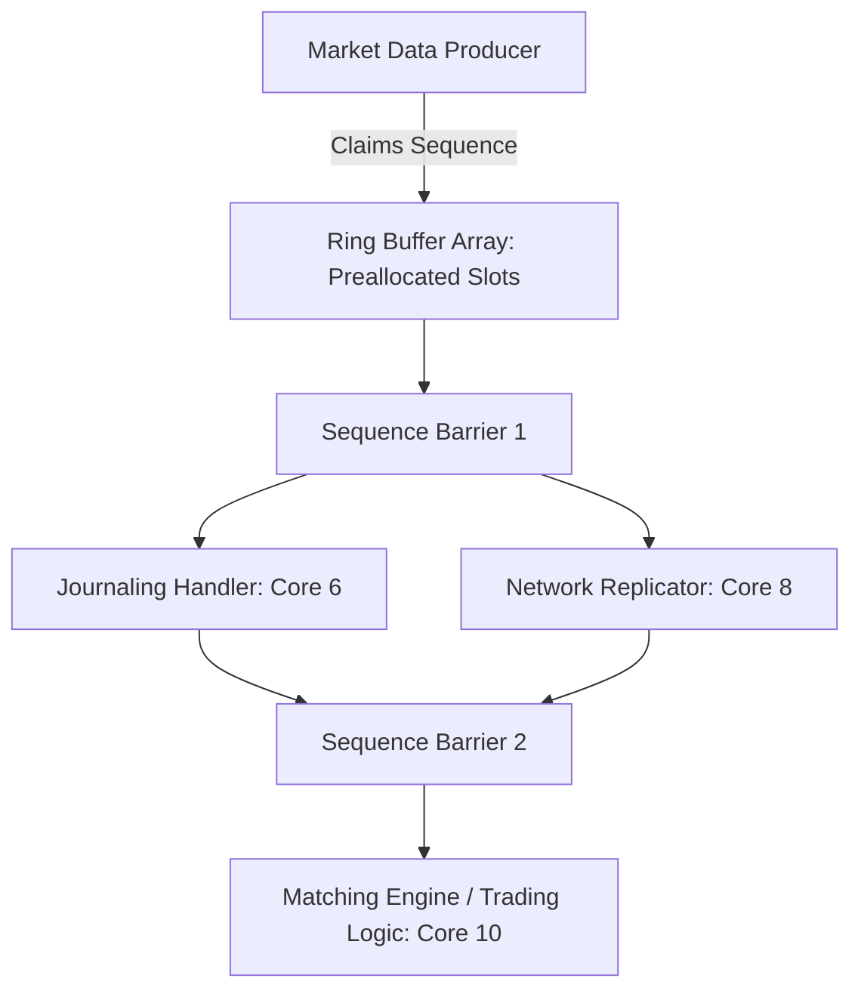

# LMAX Disruptor Architecture Pattern

The Disruptor pattern avoids lock contention and cache thrashing by using preallocated circular ring buffers and sequence barriers for parallel event processing.



---

## 1. Sequence Barriers & Dependency Graph

In the Disruptor, consumers track their progress using atomic sequence numbers. Downstream consumers wait on upstream consumers without explicit locks:

$$\text{AvailableSequence} = \min(\text{JournalerSequence}, \text{ReplicatorSequence})$$

The matching engine processes events up to $\text{AvailableSequence}$ in a single batched scan, maximizing instruction cache locality.

---

## 2. Slot Padding for Zero False Sharing

```cpp
#include <cstdint>

struct alignas(64) OrderEvent {
    uint64_t order_id;
    uint32_t symbol_id;
    int64_t price;
    uint32_t quantity;
    char side; // 'B' = Buy, 'S' = Sell
    uint64_t ingress_timestamp_ns;

    // Pad struct to exact cache line multiple (64 bytes)
    uint8_t padding[27];
};
static_assert(sizeof(OrderEvent) == 64, "OrderEvent must fill exactly one cache line");
```
