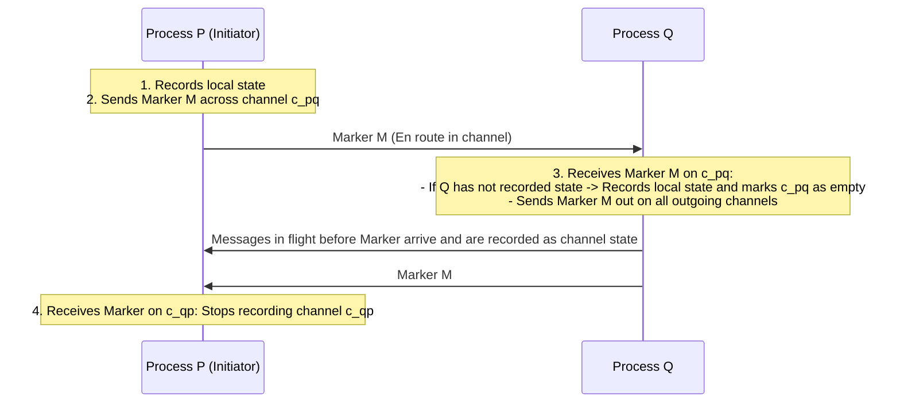

# Distributed Systems: Chandy-Lamport Global Snapshot Algorithm

The Chandy-Lamport algorithm captures a globally consistent state snapshot of a distributed system (node states and in-flight channel messages) without halting ongoing transaction processing.

---

## 1. Algorithm Invariants

1. **FIFO Channels:** Assumes all inter-process communication channels preserve FIFO message delivery.
2. **Strong Consistency:** Guarantees that the captured global snapshot represents a state that could have occurred in an actual sequential execution trace.
3. **Non-Blocking Execution:** Nodes continue executing normal application computation and receiving new requests while snapshot recording takes place.
