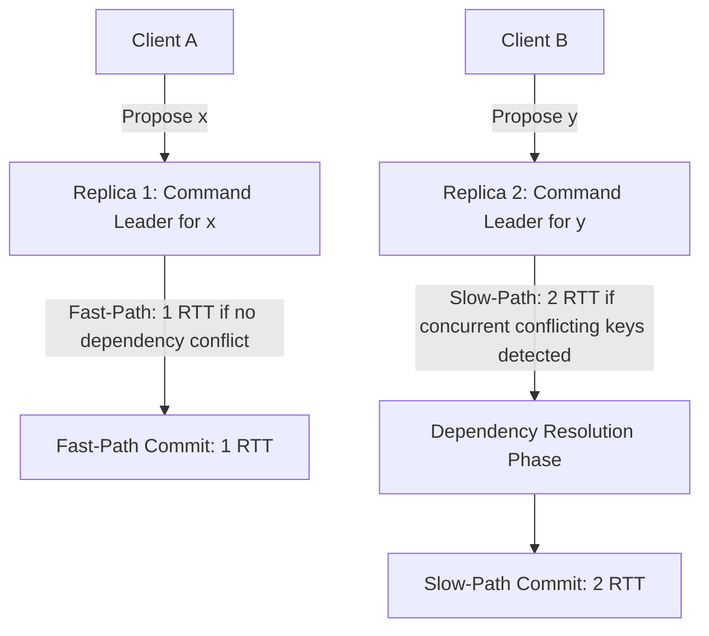

# Distributed Consensus: Egalitarian Paxos (EPaxos) & Fast-Path Quorums

Egalitarian Paxos eliminates master-leader bottlenecks by allowing any replica to propose and commit commands, dynamically resolving order dependencies through explicit dependency graphs.

---

## 1. Quorums & Dependency Graphs

1. **Fast-Path Quorum:** Size $F = f + \lfloor rac{f + 1}{2} 
floor$; if all replicas in the fast quorum agree on identical dependencies, the command commits in one round-trip.
2. **Conflict Detection:** Commands that do not commute (accessing identical state keys) record mutual dependencies ($x 	o y$ or $y 	o x$).
3. **Execution Phase:** Replicas compute topological sorting over the strongly connected components of the dependency graph, executing commands identically across all nodes.
