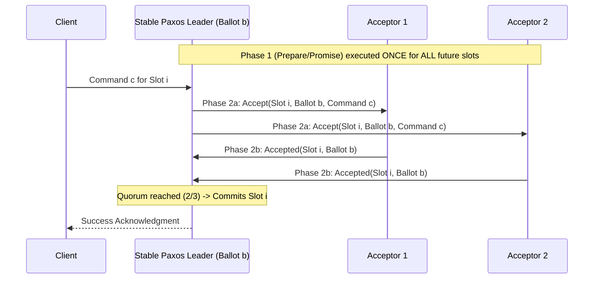

# Distributed Consensus: Multi-Decree Paxos & Stable Leader Optimization

Multi-Decree Paxos sequences an infinite stream of state machine commands across numbered consensus slots, bypassing Phase 1 (Prepare/Promise) when a stable leader is active to achieve 1-RTT consensus.

---

## 1. Slot Allocation & Gaps

* **Slot Allocation:** The leader allocates monotonically increasing integer slot indices ($1, 2, 3, \dots$) for incoming client commands.
* **Slot Holes:** If a leader fails mid-proposal, the successor leader issues Phase 1 across all uncommitted slots; any slot with no accepted value is filled with a `NOP` command to advance the continuous state machine stream.
