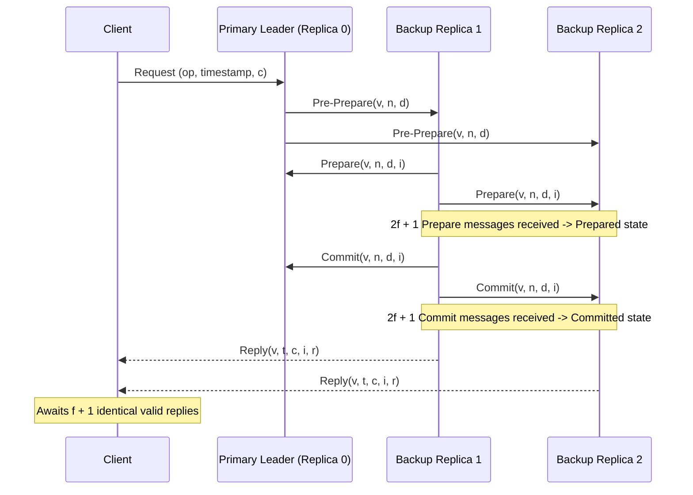

# Byzantine Consensus: Practical Byzantine Fault Tolerance (PBFT)

Castro and Liskov's PBFT algorithm achieves state machine replication in asynchronous environments vulnerable to malicious or arbitrary Byzantine failures, tolerating up to $f$ faulty nodes in a system of $3f + 1$ replicas.

---

## 1. Protocol Invariants

* **Quorum Requirements:** Total nodes $R \ge 3f + 1$; quorum threshold for both Prepare and Commit phases is $2f + 1$ valid signatures.
* **View Change:** If the primary leader stalls or behaves dishonestly, backups timeout and broadcast `VIEW-CHANGE` messages to elect primary $(v + 1) \pmod R$.
