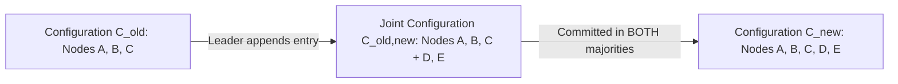

# Distributed Consensus: Raft Joint Consensus & Cluster Membership Changes

Raft cluster membership changes require transitional configurations (Joint Consensus) to prevent split-brain dual-leader scenarios where old and new cluster majorities elect separate leaders simultaneously.

---

## 1. Joint Consensus Invariants

1. **Two-Phase Transition:** Configuration change entries are committed like normal log entries. When $C_{	ext{old,new}}$ is appended, nodes immediately switch to using that configuration for rule evaluation.
2. **Dual-Majority Quorums:** In $C_{	ext{old,new}}$, decisions (elections and log entries) mandate independent majorities from **both** the old configuration $C_{	ext{old}}$ and the new configuration $C_{	ext{new}}$.
3. **Safety Guarantee:** At no point can a disjoint majority exist; $C_{	ext{old}}$ alone cannot form a quorum, and $C_{	ext{new}}$ alone cannot form a quorum until $C_{	ext{old,new}}$ is committed and replaced by $C_{	ext{new}}$.
