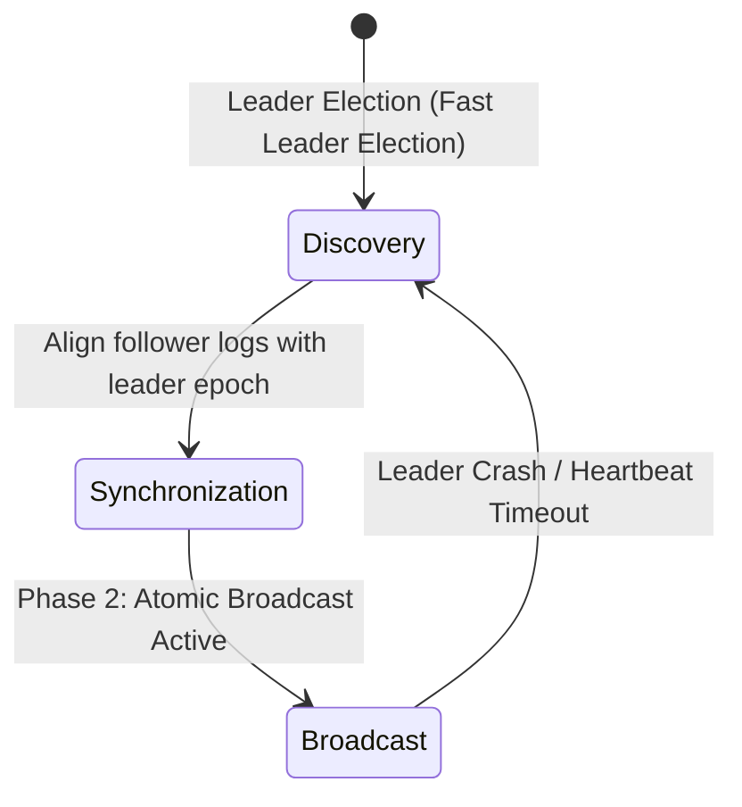

# Distributed Systems: ZooKeeper Atomic Broadcast (ZAB) Protocol

The ZAB protocol guarantees causal primary-backup order execution across ZooKeeper distributed ensembles, operating in two alternating phases: Phase 1 (Leader Activation & Recovery) and Phase 2 (Atomic Broadcast).

---

## 1. Zxid Architecture & Epoch Transitions

* **64-bit Transaction ID (`Zxid`):**
  - **Upper 32 bits (Epoch $e$):** Incremented every time a new leader completes election and enters Phase 1.
  - **Lower 32 bits (Counter $c$):** Monotonically increasing sequence number reset to zero at each new epoch.
* **Total Order Invariant:** If message $A$ is proposed before message $B$ by the leader of epoch $e$, $A$ must be delivered before $B$ by all non-faulty followers.
* **Recovery Invariant:** A newly elected leader must discard any proposal committed only by a deposed leader and synchronize all followers before accepting new client writes.
