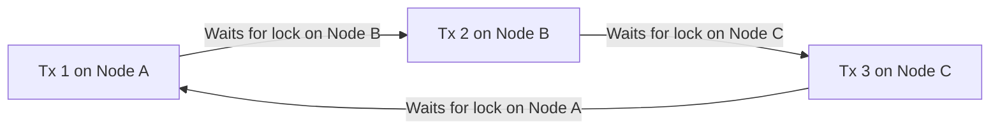

# Distributed Deadlock Detection & Edge Chasing

Deadlocks in distributed database systems occur when transactions form dependency cycles waiting on locks held across nodes.

---

## 1. Chandy-Misra-Haas Edge-Chasing Algorithm

1. When a transaction $T_i$ blocks waiting for $T_j$, it sends a **Probe Message** `<initiator, sender, receiver>`.
2. Nodes propagate probe messages along outgoing wait-for dependencies.
3. If probe `<T_i, ...>` returns back to initiating node $T_i$, a distributed deadlock cycle exists.
4. The system aborts the lowest priority transaction to resolve the cycle.
