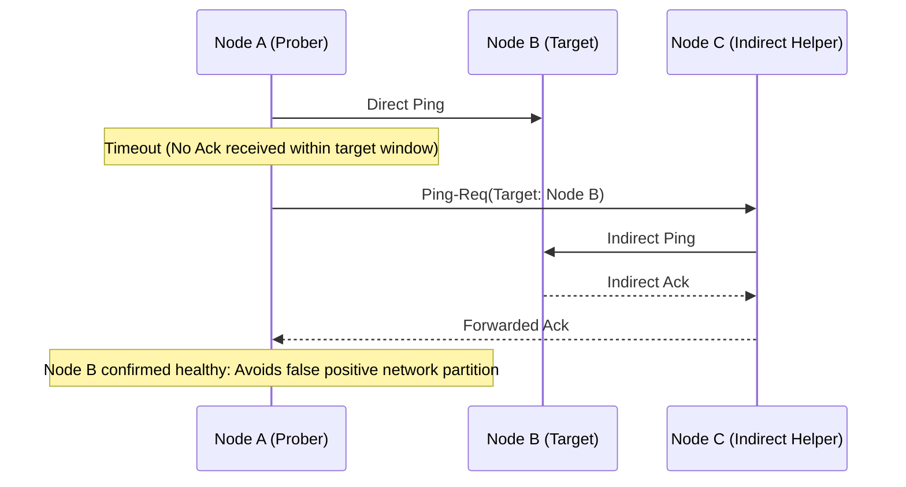

# Distributed Systems: SWIM Protocol & Gossip Failure Detection

The SWIM protocol (Structured Weakly-Consistent Infection-Style Process Group Membership) achieves scalable, constant $O(1)$ CPU/network load failure detection using randomized ping probes with indirect ping-requests.

---

## 1. Detection Periods & Suspicion Mechanism

* **Indirect Probing:** When a direct probe fails, Node A dispatches indirect `Ping-Req` messages to $k$ random members; if any helper receives an Ack, Node B is preserved as healthy.
* **Suspicion Mechanism:** Unresponsive nodes transition to `Suspect` state rather than being declared dead immediately. Suspect status propagates via gossip; if no `Alive` message arrives before timeout, the node is permanently marked `Dead`.
* **Scale-Free Bandwidth:** Per-node network message volume remains strictly constant independent of total cluster size $N$.
