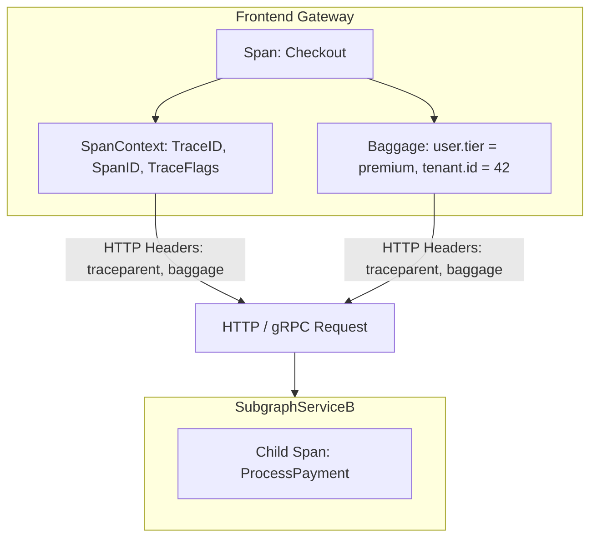

# Observability: OpenTelemetry SpanContext & Baggage Propagation

OpenTelemetry coordinates distributed transaction tracing across heterogeneous services by carrying an immutable `SpanContext` (tracing identifiers) alongside user-defined contextual metadata (`Baggage`).

---

## 1. Specification & Protocol Fields

* **`traceparent` Header (W3C):** `00-4bf92f3577b34da6a3ce929d0e0e4736-00f067aa0ba902b7-01`
  - `00`: Version
  - `4bf9...`: 16-byte TraceID (Global identifier)
  - `00f0...`: 8-byte SpanID (Parent span identifier)
  - `01`: TraceFlags bitmask (bit 0 = recorded/sampled)
* **`baggage` Header (W3C):** Key-value pairs (`baggage: userId=alice,serverNode=iad01`) propagated downstream across all child service hops, independent of trace sampling decisions.
