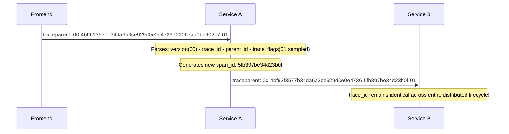

# Distributed Observability: W3C TraceContext Specification

W3C TraceContext standardizes distributed tracing HTTP headers across polyglot microservice boundaries.

---

## 1. The `tracestate` Header
Carries vendor-specific opaque routing tags (e.g. AWS X-Ray, Datadog, Jaeger) alongside the standard W3C identifier.
