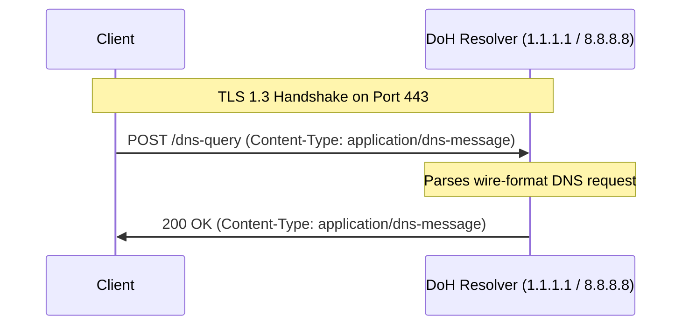

# Network Protocols: DNS-over-HTTPS (DoH RFC 8484)

DNS-over-HTTPS encrypts DNS queries inside HTTP/2 and HTTP/3 streams over port 443, mitigating ISP eavesdropping, cache poisoning, and DNS hijacking.

---

## 1. Protocol Specifics

* **Wire Format Body:** Payloads contain standard binary DNS messages (RFC 1035) transmitted without translation.
* **HTTP Methods:** Supports `POST` (binary body) and `GET` (base64url-encoded `?dns=` query string parameter), leveraging standard HTTP caching headers (`cache-control: max-age`).
