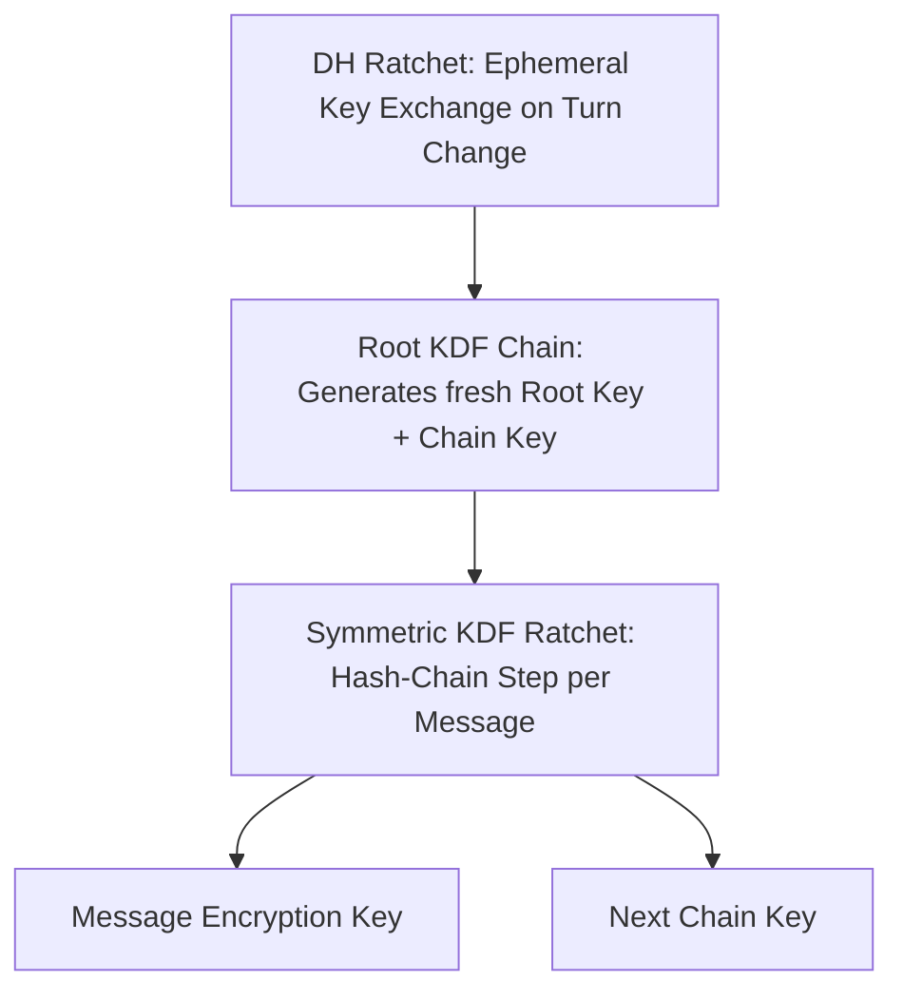

# Double Ratchet Protocol (Signal Protocol)

The Double Ratchet algorithm combines Diffie-Hellman ratchets and symmetric key derivation (KDF) ratchets to provide both Forward Secrecy and Post-Compromise Security (Break-in Recovery).

---

## 1. Security Invariants

* **Forward Secrecy:** Past communications cannot be decrypted if the current ratcheted state or long-term identity keys are compromised.
* **Break-in Recovery:** An active attacker who compromises all internal ratchet states loses decryption capability as soon as the participants execute one uncompromised DH ratchet exchange.
