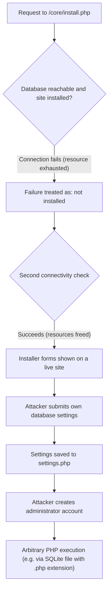

# Web Application Security: Fail-Open Installer Logic (Drupal "Fail2Install", CVE-2026-132165)

Drupal core ships `install.php`. Under specific conditions an unauthenticated attacker can make an **already installed** site believe it is not installed, then reinstall it, leading to site takeover or remote code execution. Advisory **SA-CORE-2026-017** (2026-11-18, rated Highly Critical 20/25 after exploitation was confirmed). Drupal reports exploitation on live sites as early as **2026-11-19 19:00 UTC**; CISA added it to KEV on 2026-11-24 (due 2026-11-27). Found by Anthropic's OSS Scanner and independently analysed by Searchlight Cyber.

---

## 1. Root Cause: Availability Failure Interpreted as "Not Installed"

The sequence described by researchers is **FAIL, FAIL, SUCCESS**: early database connections are refused, the existence check fails, and a later connection succeeds within the same request.

---

## 2. Resource-Exhaustion Primitives

| Primitive | What is exhausted | Effect |
| :--- | :--- | :--- |
| `EMFILE` | Per-process open file descriptor limit | Operations fail with "too many open files" |
| Database connection exhaustion | Server connection slots | Connection to configured DB refused |
| TCP source-port exhaustion | Ephemeral ports | Outbound connection to DB fails |

Searchlight Cyber reports a pre-authentication RCE across Drupal 8.9, 9, 10 and 11 in four common deployments: Apache or PHP-FPM, each with MySQL or PostgreSQL.

---

## 3. From Reinstall to Code Execution

| Step | Mechanism |
| :--- | :--- |
| 1 | Installer accepts SQLite and lets the database file path be chosen |
| 2 | No extension restriction, so a path ending in `.php` under the document root is allowed |
| 3 | Site name is stored in the SQLite file, so submitted content lands in a `.php` file |
| 4 | Stock Apache `.htaccess` blocks direct access, but a path-handling weakness in a `RewriteRule` can allow execution |

Not every exploit path needs all steps: pointing the site at an attacker-controlled database already yields takeover.

---

## 4. Affected and Fixed Versions

| Branch | Fixed in |
| :--- | :--- |
| Drupal 11.4.x | 11.4.13 |
| Drupal 11.3.x | 11.3.22 |
| Drupal 10.6.x | 10.6.22 |
| 11.2.x and below, 10.5.x and below, 8, 9 | End of life, no fix: migrate to a supported branch |

Exposure to the internet is not required. Anyone who can reach `install.php`, including from an internal or staging network, can attempt it.

---

## 5. Defensive Checklist

* **Upgrade** to a fixed release.
* **Block the installer** after installation: deny `/core/install.php` in web server configuration or the `.htaccess` in the web root. This is the interim measure if you cannot upgrade immediately.
* **Make `settings.php` immutable:** the web server user must not be able to write to it or change its permissions (mitigates some, not all, paths).
* **Drupal Steward** (paid WAF) covers known vectors but upgrading is still advised.
* **Hunt for compromise:** unexpected `.php`/`.sqlite` files under the web root, changed database host in `settings.php`, new administrator accounts, requests to `install.php` in access logs since 2026-11-18.
* **Rate and resource limits:** monitor spikes of `EMFILE`, DB connection-limit and ephemeral-port errors, which can indicate this style of attack.

---

## 6. Design Lessons

| Anti-pattern | Safer pattern |
| :--- | :--- |
| Treating any failed "is installed?" check as "not installed" | Fail closed: errors mean "unknown", so deny |
| Installer code deployed in production | Remove or disable installers after setup |
| Web server user can rewrite its own configuration | Read-only configuration, separate deploy user |
| Arbitrary file path accepted for a database file | Fixed path and extension allow-list |
| Availability bugs ignored in security review | Model resource exhaustion as an attacker primitive |

---

## References

* Drupal SA-CORE-2026-017
* CISA KEV additions, 2026-11-24
* SecurityWeek, BleepingComputer, Help Net Security, The Hacker News (2026-11-25)
* Searchlight Cyber research (Gervot, Kues)
