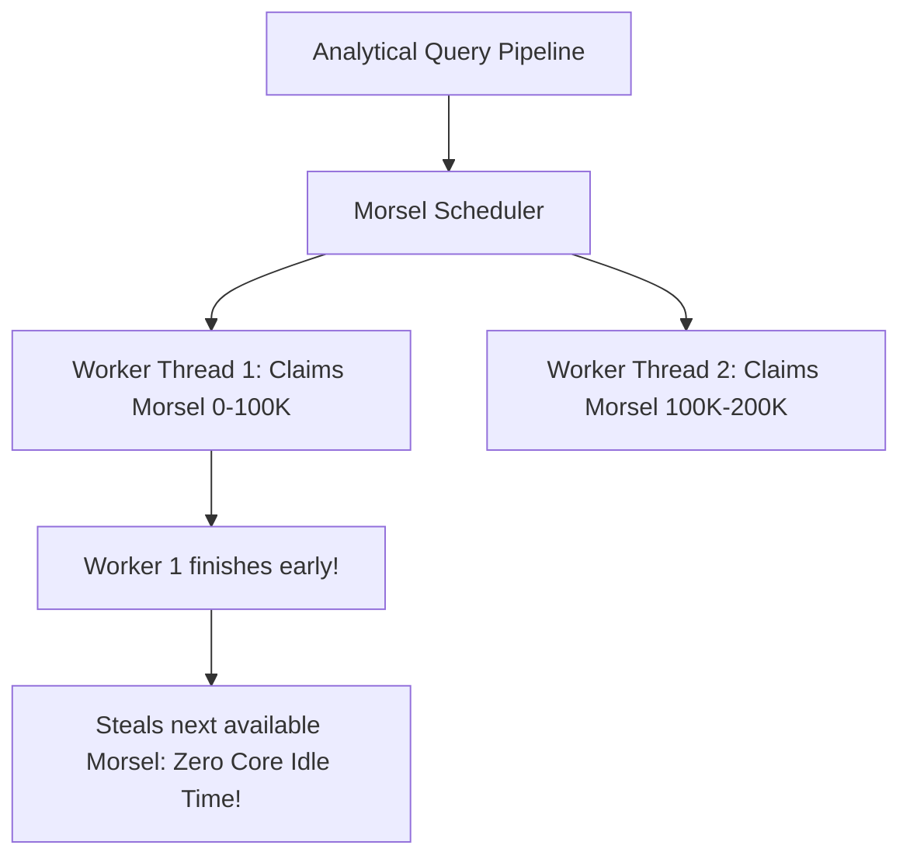

# OLAP Query Engines: DuckDB Morsel-Driven Parallelism

DuckDB parallelizes analytical SQL queries using fine-grained work stealing over 100,000-row chunks called **Morsels**.

---

## 1. NUMA Locality
Threads schedule morsels residing on their local NUMA node first before stealing from remote socket memory.
