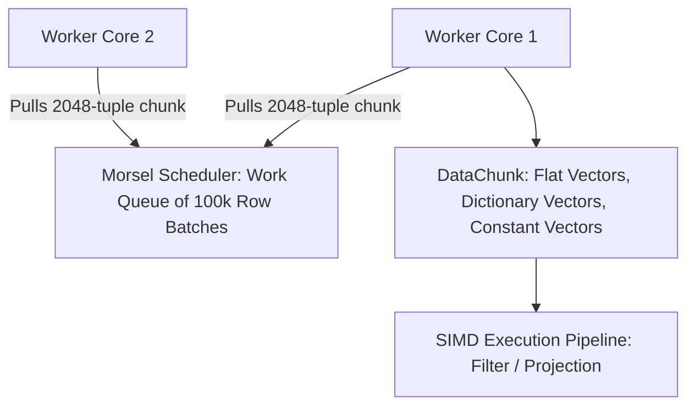

# DuckDB: Vectorized Execution & Morsel-Driven Parallelism

DuckDB achieves analytical database performance by processing data in fixed-size vector chunks (typically 2048 rows) across threads using morsel-driven scheduling.

---

## 1. Architectural Highlights

* **DataChunk Formats:** Vectors use optimized representations: Flat (contiguous primitives), Constant (single scalar broadcast), and Dictionary (indirection array over shared base data).
* **Morsel Parallelism:** Eliminates static partition skew by assigning small task morsels dynamically to idle CPU threads.
* **Push-Based Pipelines:** Operators push data chunks up the physical execution plan, preserving warm CPU register state across pipeline stages.
