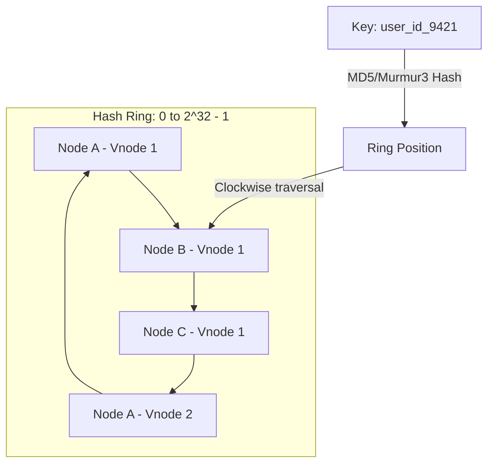

# Dynamo-Style Consistent Hashing & Token Ring Architecture

Decentralized distributed storage engines distribute key ranges across an integer hash ring using virtual nodes, maintaining balance during node membership changes and node failures.

---

## 1. Virtual Node Invariant

Assigning each physical server multiple (e.g. 128-256) virtual node positions around the ring evens out distribution variance and prevents hotspotting when hardware is added or decommissioned.
