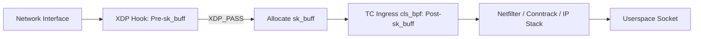

# Linux Networking: eBPF TC vs XDP Hook Architecture

Linux provides two primary ingress hooks for programmable packet processing: eXpress Data Path (XDP) and Traffic Control (TC) with `cls_bpf`.

---

## 1. Architectural Comparison

| Dimension | XDP (eXpress Data Path) | TC (Traffic Control cls_bpf) |
| :--- | :--- | :--- |
| **Execution Point** | Driver RX ring (pre-sk_buff) | `__netif_receive_skb` (post-sk_buff) |
| **Metadata Access** | Raw packet buffer only | Full `struct __sk_buff` metadata |
| **Egress Support** | Limited (`XDP_TX`) | Full ingress and egress support |
| **L7 Socket Redirection** | Via AF_XDP | Direct to socket via `bpf_sk_redirect_hash` |
