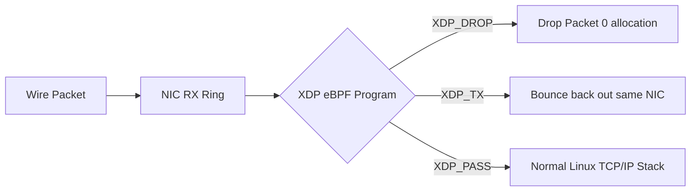

# eBPF Express Data Path (XDP) Architecture

XDP executes eBPF bytecode directly inside the network interface card (NIC) driver layer before SKB allocation in the Linux network stack.

---

## 1. Action Verdicts

- `XDP_DROP`: Immediately drops packet; processes 20M+ packets/sec per core.
- `XDP_TX`: Transmits packet back out same interface without allocating an SKB.
- `XDP_REDIRECT`: Forwards packet to another NIC or user-space `AF_XDP` zero-copy ring.
