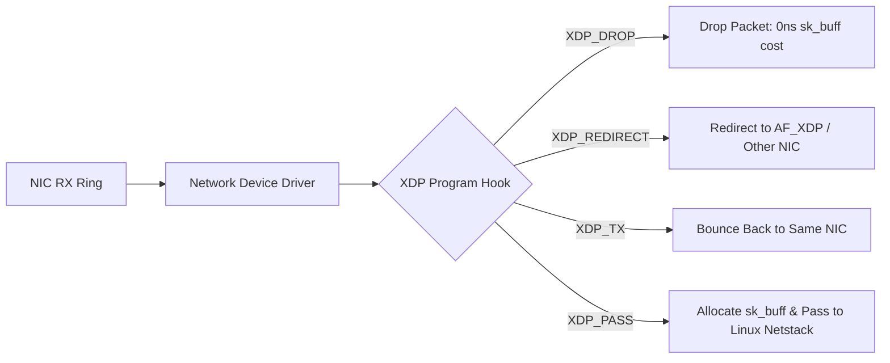

# Linux eBPF: XDP Driver Mode vs Native Mode Architecture

eBPF eXpress Data Path (XDP) provides bare-metal packet processing before Linux network stack allocation (sk_buff creation).

---

## 1. Operating Modes Comparison

| Mode | Hook Location | Overhead | Driver Support |
| :--- | :--- | :--- | :--- |
| **Offloaded XDP** | NIC Hardware / SmartNIC | 0 CPU cycles | SmartNIC hardware required (Netronome, etc.) |
| **Driver / Native XDP** | Initial driver RX queue | Pre-sk_buff allocation | Modern NIC drivers (ixgbe, mlx5, virtio_net) |
| **Generic XDP** | Post-sk_buff allocation | Low (Software emulation) | Any network interface |

---

## 2. XDP Return Actions
- `XDP_DROP`: Drops malicious/unwanted DDoS traffic immediately at ingress.
- `XDP_TX`: Forwards packet back out the same interface (e.g. fast stateful load balancing).
- `XDP_REDIRECT`: Bypasses kernel networking and transfers raw frames into AF_XDP userspace sockets.
- `XDP_PASS`: Hands off packet to conventional TCP/IP kernel stack.
