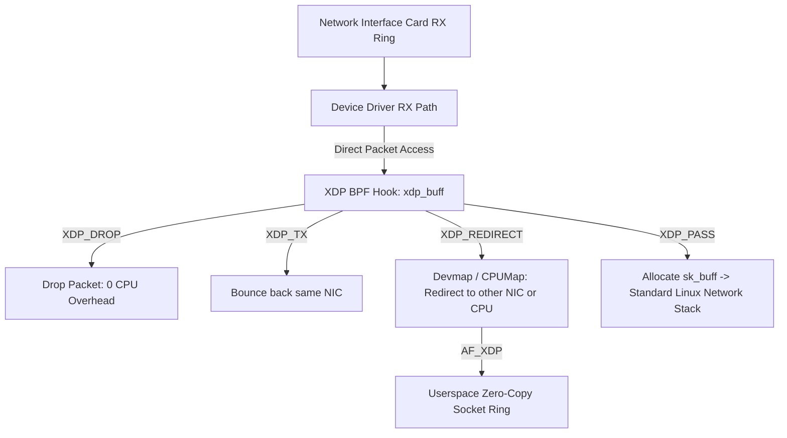

# eBPF XDP Redirect & High-Performance Packet Steering Architecture

XDP (eXpress Data Path) executes sandboxed eBPF bytecode directly inside the network device driver before allocating `sk_buff` kernel structures, enabling sub-microsecond line-rate packet filtering and redirection.



---

## 1. XDP Action Return Codes

| Action Code | Integer Value | Description |
|---|---|---|
| `XDP_ABORTED` | 0 | Unhandled program error. Drops packet and traces `xdp_exception` event. |
| `XDP_DROP` | 1 | Drops packet immediately at NIC driver level without allocating memory buffers. |
| `XDP_PASS` | 2 | Hands packet to standard Linux networking subsystem (`netif_receive_skb`). |
| `XDP_TX` | 3 | Bounces packet out the same physical interface it arrived on with minimal header modifications. |
| `XDP_REDIRECT` | 4 | Steers packet to another network interface, CPU core (`cpu_map`), or user-space `AF_XDP` socket (`xsk_map`). |

---

## 2. BPF Map Types for Fast Redirection

```c
// Redirect traffic to specialized CPU cores or network devices
struct {
    __uint(type, BPF_MAP_TYPE_DEVMAP);
    __uint(max_entries, 64);
    __type(key, __u32);
    __type(value, __u32);
} tx_ports SEC(".maps");
```
