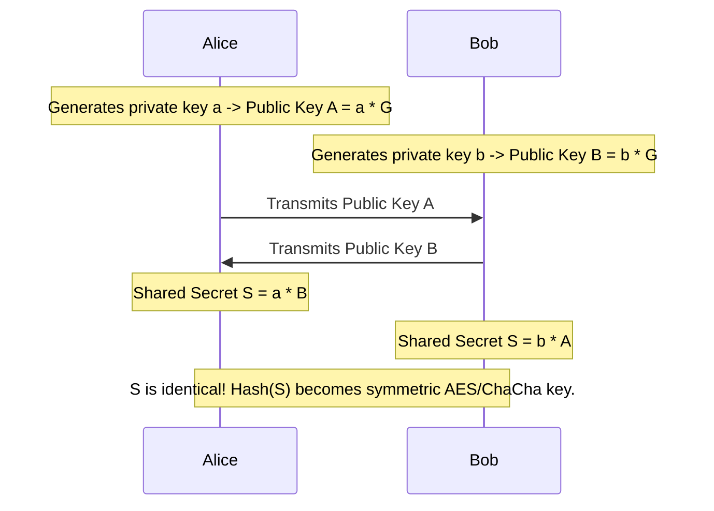

# Applied Cryptography: Curve25519 vs Secp256k1 Architecture

Elliptic Curve Diffie-Hellman (ECDH) establishes shared secret keys over insecure channels. Curve25519 (Montgomery curve) was engineered to prevent timing side channels.

---

## 1. SafeCurves Principles (Bernstein)
- Constant-time ladder step (Montgomery ladder) immune to cache-timing attacks.
- Twist-security prevents small-subgroup invalid curve attacks without explicit point validation.
