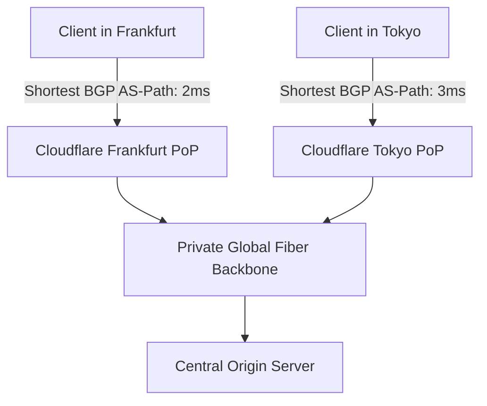

# Edge Acceleration: BGP Anycast Routing Architecture

Anycast advertises the exact same public IP block (e.g. `1.1.1.1`) from hundreds of globally distributed edge data centers simultaneously.

---

## 1. DDoS Resilience
Volumetric attacks are naturally partitioned across regional Points of Presence (PoPs), preventing core origin saturations.
