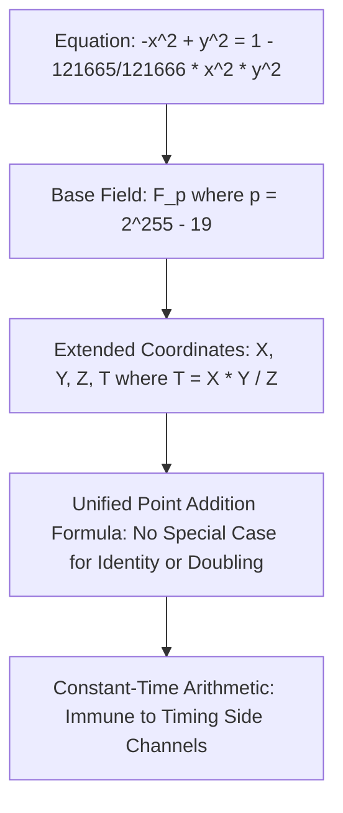

# Edwards25519 Twisted Edwards Curve Arithmetic

Edwards25519 provides complete, exception-free group operations for Ed25519 signatures, resisting side-channel timing attacks by executing identical arithmetic formulas for point addition and point doubling.

---

## 1. Unified Addition Invariant

For points $P_1 = (X_1, Y_1, Z_1, T_1)$ and $P_2 = (X_2, Y_2, Z_2, T_2)$:
$$A = (Y_1 - X_1)(Y_2 - X_2), \quad B = (Y_1 + X_1)(Y_2 + X_2)$$
$$C = 2 \cdot T_1 \cdot d \cdot T_2, \quad D = 2 \cdot Z_1 \cdot Z_2$$
$$E = B - A, \quad F = D - C, \quad G = D + C, \quad H = B + A$$
$$X_3 = E \cdot F, \quad Y_3 = G \cdot H, \quad T_3 = E \cdot H, \quad Z_3 = F \cdot G$$
No branches or special-case checks are required.
