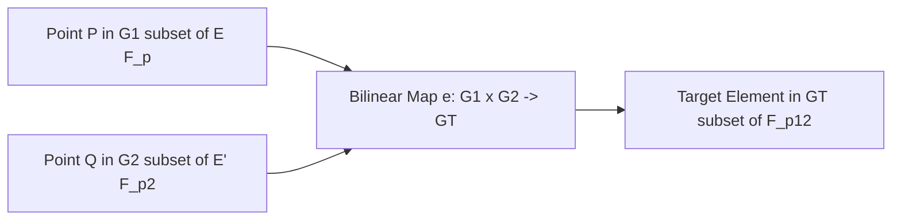

# BLS12-381 & BN254 Elliptic Curve Pairings

Bilinear pairings map pairs of elliptic curve points to multiplicative elements in an extension field, enabling polynomial commitment verification, BLS threshold signatures, and short zk-SNARKs.

---

## 1. Curve Comparison: BLS12-381 vs BN254

| Characteristic | BN254 (alt_bn128) | BLS12-381 |
|---|---|---|
| **Base Field Size ($p$)** | 254 bits | 381 bits |
| **Scalar Field Size ($r$)** | 254 bits | 255 bits |
| **Embedding Degree ($k$)** | 12 | 12 |
| **Target Field ($F_{p^{12}}$)** | 3048 bits | 4572 bits |
| **Security Level** | ~100 bits (post-Kim-Barbulescu attack) | 128 bits |
| **Primary Use Cases** | Ethereum EVM Precompiles (EIP-196/197). | Ethereum Consensus Layer (Beacon Chain), Filecoin, Zcash. |
| **Point Representation** | $G_1$: 32 bytes (compressed), $G_2$: 64 bytes. | $G_1$: 48 bytes (compressed), $G_2$: 96 bytes. |

---

## 2. Bilinearity Axioms

For all $P, P_1, P_2 \in \mathbb{G}_1$, $Q, Q_1, Q_2 \in \mathbb{G}_2$, and $a, b \in \mathbb{F}_r$:
1. $e(P_1 + P_2, Q) = e(P_1, Q) \cdot e(P_2, Q)$
2. $e(P, Q_1 + Q_2) = e(P, Q_1) \cdot e(P, Q_2)$
3. $e(aP, bQ) = e(P, Q)^{ab} = e(abP, Q) = e(P, abQ)$
4. Non-degeneracy: $P 
eq \mathcal{O}_{\mathbb{G}_1} \land Q 
eq \mathcal{O}_{\mathbb{G}_2} \implies e(P, Q) 
eq 1_{\mathbb{G}_T}$
