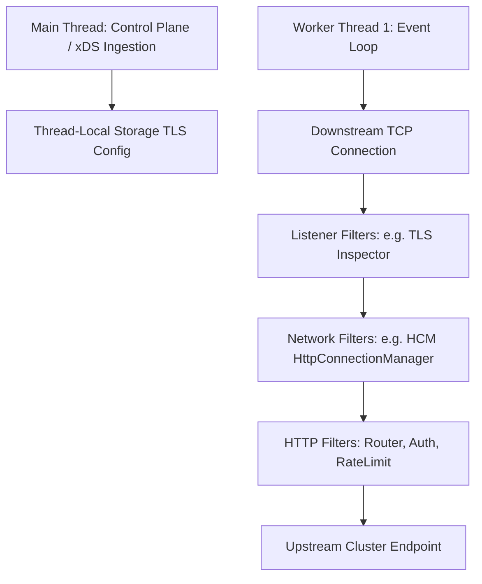

# Service Mesh Architecture: Envoy Threading & Filter Pipeline

Envoy operates a single-process, multi-threaded event-driven architecture using `libevent`, where each worker thread runs an independent non-blocking event loop.

---

## 1. Lock-Free Design
Worker threads run without cross-thread lock contention. Configuration updates from xDS are pushed via Thread-Local Storage (TLS) pointers atomically.
