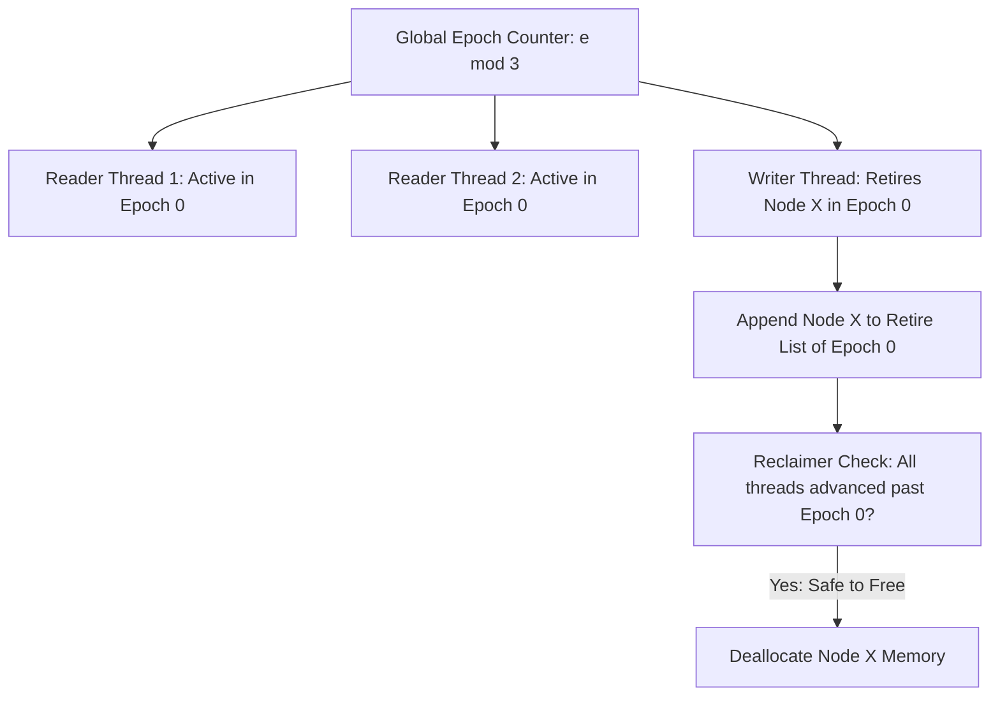

# Epoch-Based Reclamation (EBR) Lock-Free Architecture

Epoch-Based Reclamation permits safe memory deallocation in lock-free concurrent data structures without hardware hazard pointers or garbage collection by tracking reader execution epochs.

---

## 1. 3-Epoch Rotation Guarantee

Memory retired in epoch $e$ can only be referenced by threads that entered the data structure in epoch $e$. Once all threads announce an active epoch of $e+1$ or higher, no thread holds references to epoch $e$ retire lists, making deallocation safe.
